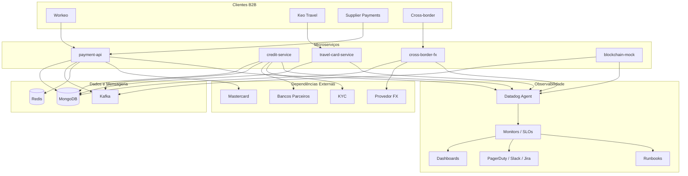

# Keo Capital — Projeto de Observabilidade e SRE com Datadog

> Projeto de observabilidade e gestão de incidentes para a Keo Capital, fintech B2B de crédito, pagamentos e working capital listada em Estocolmo (STO:KEOC).

---

## 📋 Sobre a Keo Capital

A **Keo Capital AB (publ)** é uma fintech B2B focada em soluções de crédito, pagamentos e working capital, com operações na América Latina (desde 2020), Canadá e Américas. A empresa é listada na Nasdaq Stockholm (ticker: KEOC).

### Produtos e Soluções

| Produto | Descrição |
|---|---|
| **Workeo** | Plataforma de working capital para empresas mid-market e enterprise |
| **Keo Travel** | Cartões virtuais para gastos de viagens corporativas (desde 2022) |
| **Supplier Payments** | Pagamentos a fornecedores com cartões virtuais e working capital integrado |
| **Corporate Travel Solutions** | Gestão de gastos de viagem com cartões virtuais |
| **Local Supplier Solutions** | Soluções locais de pagamento a fornecedores |
| **Cross-border Card Program** | Programa de cartão cross-border (parceria estratégica com Mastercard) |

### Parcerias Estratégicas
- **Mastercard** — parceria para expandir o programa de cartão cross-border

---

## 🏗️ Camadas de Abstração do Projeto

O projeto está organizado em 7 camadas de abstração, do mais baixo nível (infraestrutura) ao mais alto (negócio):

```
┌─────────────────────────────────────────────────────────────┐
│  7. Incident Management Layer (MTTR, MTBF, On-call)        │
├─────────────────────────────────────────────────────────────┤
│  6. Security & Compliance Layer (PCI-DSS, Fraud, Audit)     │
├─────────────────────────────────────────────────────────────┤
│  5. External Dependencies Layer (Mastercard, Banks, FX)     │
├─────────────────────────────────────────────────────────────┤
│  4. Business/Transaction Layer ⭐ (Auth rate, Volume)      │
├─────────────────────────────────────────────────────────────┤
│  3. Application Layer (APM, Errors, Profiling)             │
├─────────────────────────────────────────────────────────────┤
│  2. Platform Layer (API GW, Kafka, Redis, Mesh)            │
├─────────────────────────────────────────────────────────────┤
│  1. Infrastructure Layer (Compute, Network, Storage)        │
└─────────────────────────────────────────────────────────────┘
```

### Prioridade de Implementação
1. **Business/Transaction** — SLOs de autorização de cartão e disponibilidade
2. **Application** — APM e tracing nas APIs críticas
3. **External Dependencies** — Monitoramento de Mastercard e bancos
4. **Infrastructure** — Base de métricas de infraestrutura
5. **Security & Compliance** — PCI-DSS e fraud detection
6. **Platform** — Métricas de middleware
7. **Incident Management** — Processo e métricas de incidentes (contínuo)

---

### Arquitetura (visão geral)



## 📁 Estrutura do Repositório

```
keo-capital-sre/
├── README.md
├── docs/
│   ├── levantamento/          # Levantamento da empresa e negócio
│   ├── arquitetura/           # Arquitetura de observabilidade
│   ├── slos/                  # Definição de SLOs/SLIs
│   ├── runbooks/              # Procedimentos de incidentes
│   ├── dashboards/            # Especificações de dashboards
│   └── integracoes/           # Documentação de integrações
├── monitors/
│   ├── infrastructure/        # Monitors de infraestrutura
│   ├── application/           # Monitors de aplicação
│   ├── business/              # Monitors de negócio/transações
│   ├── security/              # Monitors de segurança/compliance
│   └── external-dependencies/ # Monitors de dependências externas
├── dashboards/                # Definições de dashboards (JSON)
├── terraform/                 # IaC para Datadog (monitors, dashboards)
├── modules/                   # Módulos reutilizáveis
├── alerts/                    # Configurações de alertas
├── runbooks/                  # Runbooks operacionais
└── scripts/                   # Scripts de automação
```

---

## 🎯 SLOs Principais

| Métrica | SLI | SLO | Produto |
|---|---|---|---|
| Taxa de sucesso de autorização de cartão | ≥ 99.5% | 99.5% | Keo Travel, Cross-border |
| Latência de autorização (P99) | < 300ms | 300ms | Todos os cartões |
| Disponibilidade do serviço de pagamentos | ≥ 99.9% | 99.9% | Todos |
| Tempo de processamento de working capital (P95) | < 5s | 5s | Workeo |
| Taxa de aprovação de crédito | Baseline por produto | Baseline | Workeo |

---

## 📊 Custom Metrics (Datadog)

```
keo.payments.authorization.success_rate
keo.payments.authorization.latency_p99
keo.credit.approval_rate{product:workeo}
keo.travel.card_creation.latency
keo.crossborder.transaction.volume{region:latam}
keo.working_capital.disbursement.latency_p95
```

---

## 🔗 Integrações Planejadas

- **PagerDuty/Opsgenie** — Gestão de incidentes e on-call
- **Slack/Teams** — Notificações de alertas
- **Jira** — Tracking de incidentes e melhorias
- **GitHub/GitLab** — Correlação de deploys com incidentes
- **Mastercard Network** — Monitoramento de dependência externa

---

## 📝 Convenção de Tags

```
env:prod|staging|dev
region:latam|canada|us|eu
service:<nome-do-servico>
team:sre|payments|credit|travel
product:workeo|keo-travel|cross-border|supplier-payments
```

---

## 🚀 Como Rodar (Build, Testes e CI/CD)

### Pré-requisitos
- JDK 21
- Maven 3.9+
- Docker (para docker-compose e Testcontainers)

### Configuração
```bash
cp .env.example .env
# edite .env com suas credenciais Datadog
```

### Build e testes (via Makefile)
```bash
make build      # compilar
make test       # testes unitários
make verify     # build completo (compile + test + package)
```

Ou diretamente com Maven:
```bash
mvn -B clean verify
```

### Docker Compose
```bash
make up    # docker compose up -d
make down  # docker compose down
```

### Terraform
```bash
make tf-init
make tf-fmt
make tf-validate
make tf-plan
```

### CI/CD
Os workflows estão em `.github/workflows/`:
- `ci.yml` — build, testes, build de imagens Docker e Terraform plan.
- `deploy.yml` — build/push de imagens e deploy via docker-compose.
- `terraform.yml` — Terraform apply para Datadog.

### Estrutura do repositório (atualizada)
```
keo-capital-sre/
├── code/            # microserviços (Spring Boot)
├── monitors/        # definições de monitors Datadog
├── runbooks/        # runbooks operacionais
├── docs/            # documentação
├── terraform/       # IaC Datadog
└── .github/workflows/  # CI/CD
```

---

## 👤 Autor

Rodrigo Galvão — SRE @ Keo Capital